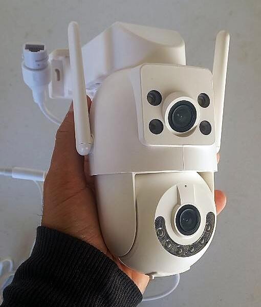

# JOOAN W3-U local firmware

  
   
  The camera this project targets: JOOAN W3-U (<code>JA-A12</code>), dual lens.

Local-first firmware for one exact camera, the JOOAN W3-U (`JA-A12`). It
cuts the camera off from the JOOAN cloud and P2P services and replaces them
with local, authenticated services: a web console, SSH, RTSP video, and ONVIF
pan/tilt and presets for an NVR such as Frigate.

This is not a complete open-source firmware. The vendor bootloader, Linux 3.10
kernel, kernel modules, sensor tuning and radio firmware stay, and so does
the vendor's camera program `jooanipc`, as a fallback. Two layers are
installed on top:

- the **platform** (this repository's root) installs into the writable `/opt`
  partition. It provides the web console and API, SSH, Wi-Fi, clock and
  signed updates, and it keeps the camera off the Internet;
- the **media daemon** [jooanipc-open](media/) installs into the application
  partition. It serves video, ONVIF and pan/tilt, so that in a normal (native)
  boot the vendor's program never starts.

[Architecture](docs/ARCHITECTURE.md) explains the boot modes and the trust
boundary.

## Status

- **Engineering pre-release; nothing is supported yet.** Releases are tested
  on one physical camera. A release becomes supported only once signed
  install and uninstall, migration, Wi-Fi, network time, SSH, routing,
  power-loss and cold-recovery checks pass on that camera
  ([hardware promotion gates](tests/TEST_PLAN.md#hardware-promotion-gates)).
- **Published: v0.2.21** (2026-10-16, platform only). Anyone with a matching
  camera can install it over Wi-Fi with no extra hardware (see
  [Installation](docs/INSTALL.md)). In v0.2.21, video still comes from the
  vendor's program, running confined.
- **Not published: 0.2.22 to 0.2.33.** This repository and its documents
  describe 0.2.33, which only the maintainer can install today. Its media
  layer needs files rebuilt from each owner's own camera, and there is no
  first-install tool yet.

## Exact hardware scope

Use this project only with a unit that matches all of the following:

- product/model reported by the OEM firmware: `JA-A12` / package token `A12`;
- PCB: `JA-6621 V1.0`;
- SoC: Ingenic T23N;
- sensors: dual `cv2005` and `cv2005s1`;
- radio: USB SeekWave SKW6316 (`SV6160LITE` on the verified unit);
- flash: 8 MiB SPI NOR (verified unit: Puya P25Q64HA).

The verified unit's retail box reads: brand `JOOAN`, model `W3-U`, FCC ID
`2BBQ4-W3U`, 5 V / 1.5 A. That identifies only the product name, which is not
enough on its own: the checklist above decides compatibility. The Thingino
image named "Jooan W3-U" targets a different SC2336P/ATBM6132U revision and is
not interchangeable. Product name and case shape are not compatibility
evidence. Read [Compatibility](docs/COMPATIBILITY.md) before installing
anything.

## What works and what doesn't

With 0.2.33 and its media layer:

- **Works:** RTSP for both lenses (1920×1080 and 1024×576 at 15 fps, H.264);
  ONVIF pan/tilt and 16 named presets for Frigate; homing on every boot; flip,
  manual night/IR-cut and white light; one admin UI at `https://<camera>/`
  for phones and computers (`http://<camera>/` redirects there); SSH; Wi-Fi with
  a network list, a static address, stage, commit and rollback; restart, a daily restart and reset
  to defaults; privacy mode; a preset patrol; exact ONVIF moves;
  optional network time from a local server; mDNS; signed updates.
- **Off by default, works with `audio=1`:** audio (microphone on RTSP, talk
  through the speaker from Frigate, the admin UI or the API).
- **Missing:** a siren; motion and person detection; digital zoom; a logo on the picture;
  on-camera recording (off in the qualified profile: record with the NVR) and SD-card
  management; any cloud or phone-app access.

[OEM comparison](docs/OEM-COMPARISON.md) compares this firmware with the
vendor firmware item by item.

## Install

Follow [Installation](docs/INSTALL.md). The first install goes over Wi-Fi
through the vendor firmware's own updater, and later updates go through the
web console. No SD card, cable or flash programmer is needed, and the camera
stays closed. A flash programmer matters only for recovering a camera that no
longer boots ([Recovery](docs/RECOVERY.md)).

## Security in brief

- The camera must live on a network that blocks its Internet access. For a
  few seconds at every boot, the vendor's web server runs before this firmware
  takes over. The firmware removes the camera's default routes but has no
  packet filter, so router isolation is the real boundary.
- The web console and API are plain HTTP on port 80. A request must address
  the camera by a private or loopback IP address or by its own name (default
  `jooan-w3u`, alone or ending in `.local`, `.lan`, `.home.arpa` or
  `.internal`). Anything else gets `403 host_rejected`.
- Sign-in is `admin` with initial password `admin`. It stays valid until it
  is changed on the System page, and SSH uses the same password. The media
  daemon has its own credentials, its own TLS certificate and a failed-login
  throttle.
- `telnetd` and the vendor web server are killed every second. When the
  vendor's program runs (fallback modes only), a guard blocks its cloud
  traffic and keeps its listeners on loopback.

Details: [Network security](docs/NETWORK-SECURITY.md) and
[Security policy](SECURITY.md), which also covers how to report a
vulnerability.

## Repository layout

| Path | Contents | License |
| --- | --- | --- |
| `build.sh`, `build-uninstall.sh`, `release.sh` | release entry points ([Building](docs/BUILDING.md)) | GPL-2.0-only |
| `packaging/` | exact-target manifest and IronMan package assembly | GPL-2.0-only |
| `runtime/` | boot hook, supervisor, slot and maintenance scripts | GPL-2.0-only |
| `src/` | `joan-daemon` (web console and API), the containment guard, release verifiers, package tooling | GPL-2.0-only |
| `web/` | the web console | GPL-2.0-only |
| `tools/` | `upload_ota.py` (first install), toolchain fetch, Wi-Fi diagnostics | GPL-2.0-only |
| `tests/`, `ci/` | host-side validation | GPL-2.0-only |
| `docs/` | documentation | GPL-2.0-only |
| [`media/`](media/) | media daemon `jooanipc-open`, its boot scripts, appfs tools and release-bundle installer | MIT |

The `libimp.so` that the media daemon loads is built from the OpenIMP fork,
branch [`jooan/oem-t23-abi`](https://github.com/ADCDS/openimp/tree/jooan/oem-t23-abi),
which is a separate repository.

The repository and its releases contain no factory secrets, Wi-Fi
credentials, device keys, flash dumps, OEM firmware or other vendor binaries.
Where a retained OEM component is needed, it comes from the owner's own
camera. A media-layer bundle carries an appfs image rebuilt from that camera,
so it stays private.

## Documentation

- [Installation](docs/INSTALL.md): installing a published release.
- [Compatibility](docs/COMPATIBILITY.md): how to tell whether your camera is the
  supported one.
- [OEM comparison](docs/OEM-COMPARISON.md): what this firmware lacks compared
  with the vendor firmware.
- [Recovery](docs/RECOVERY.md): uninstalling, rolling back and SPI recovery.
- [Network security](docs/NETWORK-SECURITY.md): listeners, Host checks, Wi-Fi,
  isolation.
- [Architecture](docs/ARCHITECTURE.md): boot modes, retained components,
  feature coverage.
- [API](docs/API.md): the platform's `/api/v1/`.
- [Building and releasing](docs/BUILDING.md): toolchain, signing, size budget,
  release bundles, qualification checklist.
- [Media daemon](media/README.md) and
  [hardware integration](media/docs/hardware.md).
- [Test plan](tests/TEST_PLAN.md), [Third-party components](docs/THIRD_PARTY.md),
  [Security policy](SECURITY.md).

## License

The platform (everything outside `media/`) is licensed under
[GPL-2.0-only](LICENSE); `media/` is MIT ([media/LICENSE](media/LICENSE)).
Every file carries its own SPDX header and keeps its own license, including
where an MIT script sources a GPL one at run time. The platform links the
camera's own Mbed TLS libraries under an additional permission, whose exact
text is in [Third-party components](docs/THIRD_PARTY.md#mbed-tls-linking-exception).
No license is granted for OEM or third-party artifacts that are not in the
repository.
