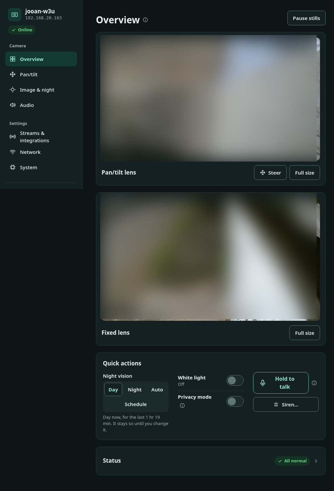
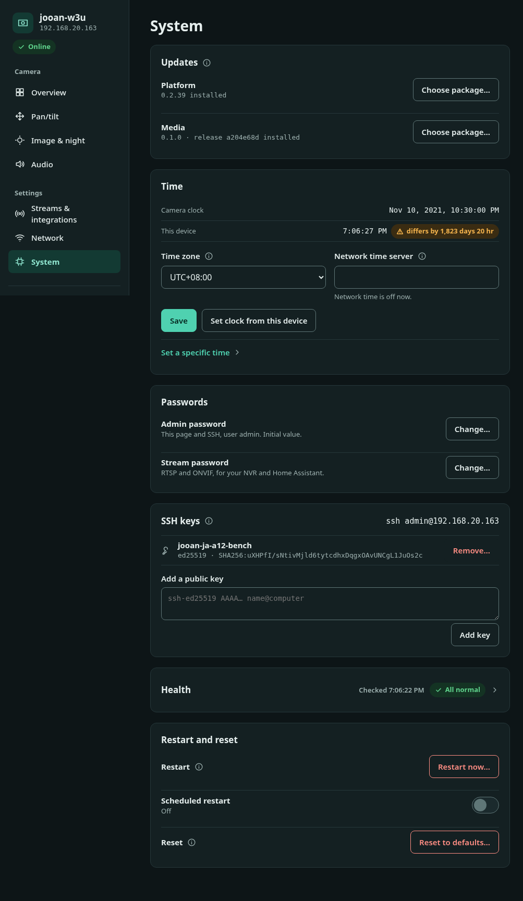
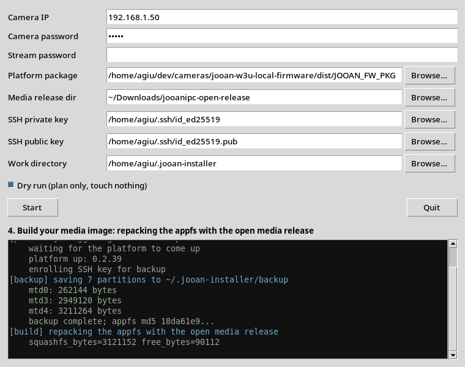

<!-- Translated from README.md. Authoritative version: ../../../README.md -->

# Firmware local pour JOOAN W3-U

  
   
  La caméra ciblée par ce projet : JOOAN W3-U (<code>JA-A12</code>), à double objectif.

Un firmware qui privilégie le fonctionnement local, conçu pour un seul modèle
de caméra bien précis : la JOOAN W3-U (`JA-A12`). Il coupe la caméra du
cloud et des services P2P de JOOAN et les remplace par des services locaux et
authentifiés : une console web, SSH, la vidéo RTSP, ainsi que le pilotage
panoramique/inclinaison et les préréglages ONVIF pour un NVR tel que Frigate.

Il ne s’agit pas d’un firmware open source complet. Le bootloader du fabricant,
le noyau Linux 3.10, les modules du noyau, les réglages des capteurs et le
firmware radio restent en place, tout comme le programme caméra du fabricant,
`jooanipc`, conservé comme solution de repli. Deux couches s’installent
par-dessus :

- la **plateforme** (la racine de ce dépôt) s’installe dans la partition `/opt`,
  accessible en écriture. Elle fournit la console web et l’API, SSH, le Wi-Fi,
  l’horloge et les mises à jour signées, et elle tient la caméra à l’écart
  d’Internet ;
- le **démon média** [jooanipc-open](../../../media/) s’installe dans la
  partition applicative. Il assure la vidéo, ONVIF et le pilotage
  panoramique/inclinaison, si bien que, lors d’un démarrage normal (natif), le
  programme du fabricant ne se lance jamais.

[Architecture](../../../docs/ARCHITECTURE.md) décrit les modes de démarrage et
la frontière de confiance.

  
   
  La console web locale (vues des deux objectifs floutées). Elle s’exécute sur la caméra,
  n’a besoin d’aucun cloud et parle sept langues. D’autres vues ci-dessous.

## État

- **Préversion technique ; rien n’est encore pris en charge.** Les versions
  sont testées sur une seule caméra physique. Une version n’est considérée
  comme prise en charge qu’une fois que les vérifications suivantes ont réussi
  sur cette caméra : installation et désinstallation signées, migration,
  Wi-Fi, heure réseau, SSH, routage, coupure de courant et récupération à froid
  ([critères de promotion sur matériel](../../../tests/TEST_PLAN.md#hardware-promotion-gates)).
- **Dernière version : v0.2.40** (2026-11-09) : le paquet de la plateforme
  ainsi que les binaires et les scripts de la couche média. Chaque
  propriétaire construit toujours lui-même l’image destinée à sa caméra à
  partir de la partition applicative de cette même caméra, car celle-ci
  contient des fichiers du fabricant : aucune image n’est donc publiée.
  Cette version remplace la v0.2.39 et intègre deux correctifs de défauts
  relevés sur le matériel : un réseau Wi-Fi ouvert (sans mot de passe) peut
  désormais être validé via la plateforme, et une plateforme fraîchement
  installée libère juste assez de place dans `/opt` pour la première
  installation de la couche média.
- **La chaîne complète a désormais été déroulée sur une vraie caméra, du firmware d’origine jusqu’à la pile logicielle ouverte.**
  Une caméra de test a été ramenée à son firmware d’origine, connectée au
  Wi-Fi sans l’application du fabricant, mise à jour sans fil (OTA) vers la
  plateforme, puis flashée avec une image média construite à partir de sa
  propre partition ; elle a diffusé la vidéo en RTSP et a fonctionné avec un
  NVR local. Elle a depuis été réinstallée une seconde fois avec cette version,
  en repartant du firmware d’origine (voir
  [le rapport d’aller-retour sur matériel](../../../docs/reports/hardware-roundtrip-20261108.md) et
  [La couche média](./INSTALL.md#the-media-layer)). Il s’agit toujours d’une
  préversion : effectuez la sauvegarde complète prévue par l’installateur et
  gardez la caméra sous tension pendant le flashage.
- **v0.2.21** (2026-10-16, plateforme seule) reste publiée. Avec elle, la vidéo
  provient toujours du programme du fabricant, exécuté en mode confiné.
  Préférez la v0.2.40.

## Périmètre matériel exact

N’utilisez ce projet qu’avec un appareil qui remplit toutes les conditions
suivantes :

- produit/modèle indiqué par le firmware OEM : `JA-A12` / jeton de paquet `A12` ;
- PCB : `JA-6621 V1.0` ;
- SoC : Ingenic T23N ;
- capteurs : deux capteurs, `cv2005` et `cv2005s1` ;
- radio : SeekWave SKW6316 en USB (`SV6160LITE` sur l’appareil vérifié) ;
- flash : SPI NOR de 8 Mio (appareil vérifié : Puya P25Q64HA).

L’emballage commercial de l’appareil vérifié indique : marque `JOOAN`, modèle
`W3-U`, FCC ID `2BBQ4-W3U`, 5 V / 1,5 A. Cela n’identifie que le nom du
produit, ce qui ne suffit pas à lui seul : c’est la liste de contrôle ci-dessus
qui détermine la compatibilité. L’image Thingino nommée « Jooan W3-U » cible
une autre révision, SC2336P/ATBM6132U, et n’est pas interchangeable. Ni le nom
du produit ni la forme du boîtier ne prouvent la compatibilité. Lisez
[Compatibilité](../../../docs/COMPATIBILITY.md) avant toute installation.

## Ce qui fonctionne et ce qui ne fonctionne pas

Avec la version 0.2.40 et sa couche média :

- **Fonctionne :** RTSP pour les deux objectifs
  (1920×1080 et 1024×576 à 15 images/s, H.264) ; pilotage
  panoramique/inclinaison ONVIF et 16 préréglages nommés pour Frigate ; prise
  d’origine des moteurs à chaque démarrage ; retournement de l’image, commande
  manuelle du mode nuit et du filtre IR-cut, lumière blanche ; une interface
  d’administration unique, à l’adresse `https://<camera>/`, pour téléphones et
  ordinateurs (`http://<camera>/` y redirige) ; SSH ; Wi-Fi avec liste des réseaux,
  adresse statique, mise à l’essai, validation et retour arrière ; redémarrage,
  redémarrage quotidien et réinitialisation aux valeurs par défaut ; mode
  privé ; ronde entre préréglages ; déplacements ONVIF précis ; heure réseau
  optionnelle depuis un serveur local ; mDNS ; mises à jour signées.
- **Actif sauf si `audio=0` :** l’audio (micro sur RTSP, prise de parole via le
  haut-parleur depuis Frigate, l’interface d’administration ou l’API).
- **Absent :** détection de mouvement et de personnes ; zoom numérique ; logo
  incrusté sur l’image ; enregistrement sur la caméra (désactivé dans le profil
  qualifié : enregistrez avec le NVR) et gestion de la carte SD ; tout accès
  par le cloud ou par une application mobile.

[Comparaison avec le firmware OEM](../../../docs/OEM-COMPARISON.md) confronte,
point par point, ce firmware à celui du fabricant.

  
   
  La page Système : versions de la plateforme et de la couche média, mises à jour, heure, mots de passe,
  clés SSH et réinitialisation — le tout sur la caméra, sans cloud.

## Installation

Suivez le guide [Installation](./INSTALL.md). La première installation se fait
par Wi-Fi, via l’outil de mise à jour intégré au firmware du fabricant ; les
mises à jour suivantes passent par la console web. Aucune carte SD, aucun câble
ni aucun programmateur de flash n’est requis, et la caméra reste fermée. Un
programmateur de flash n’est utile que pour récupérer une caméra qui ne
démarre plus ([Récupération](./RECOVERY.md)).

Pour une installation guidée sans terminal, l’[installateur](../../../installer/)
regroupe toute la séquence — provisionnement, mise à jour de la plateforme,
sauvegarde, construction de l’image et flashage — dans une seule fenêtre. Il
démarre en mode simulation (dry run), qui planifie tout sans rien toucher ; il
affiche un journal en direct et ne demande confirmation qu’une seule fois, juste
avant l’unique étape irréversible.

  
   
  L’installateur en une seule fenêtre (<code>python3 installer/gui.py</code>) pilotant les cinq étapes.

## La sécurité en bref

- La caméra doit se trouver sur un réseau qui lui bloque l’accès à Internet.
  Pendant quelques secondes, à chaque démarrage, le serveur web du fabricant
  tourne avant que ce firmware ne prenne le relais. Le firmware supprime les
  routes par défaut de la caméra mais n’a aucun filtre de paquets : c’est donc
  l’isolation au niveau du routeur qui constitue la véritable frontière.
- La console web et l’API fonctionnent en HTTP non chiffré sur le port 80. Une
  requête doit désigner la caméra par une adresse IP privée ou de bouclage, ou
  par son propre nom (par défaut `jooan-w3u`, seul ou suivi de `.local`,
  `.lan`, `.home.arpa` ou `.internal`). Toute autre requête reçoit
  `403 host_rejected`.
- L’identifiant de connexion est `admin`, avec le mot de passe initial `admin`.
  Celui-ci reste valable jusqu’à ce qu’il soit modifié sur la page Système, et
  SSH utilise le même mot de passe. Le démon média dispose de ses propres
  identifiants, de son propre certificat TLS et d’une limitation des tentatives
  de connexion échouées.
- `telnetd` et le serveur web du fabricant sont tués toutes les secondes.
  Lorsque le programme du fabricant tourne (modes de repli uniquement), un
  garde-fou bloque son trafic vers le cloud et cantonne ses services en écoute
  à l’interface de bouclage.

Détails : [Sécurité réseau](../../../docs/NETWORK-SECURITY.md) et
[Politique de sécurité](../../../SECURITY.md), qui explique aussi comment
signaler une vulnérabilité.

## Organisation du dépôt

| Chemin | Contenu | Licence |
| --- | --- | --- |
| `build.sh`, `build-uninstall.sh`, `release.sh` | points d’entrée pour produire les versions ([Compilation](../../../docs/BUILDING.md)) | GPL-2.0-only |
| `packaging/` | manifeste de la cible exacte et assemblage du paquet IronMan | GPL-2.0-only |
| `runtime/` | hook de démarrage, superviseur, scripts de gestion des emplacements (slots) et de maintenance | GPL-2.0-only |
| `src/` | `joan-daemon` (console web et API), le garde-fou de confinement, les vérificateurs de versions, l’outillage des paquets | GPL-2.0-only |
| `web/` | la console web | GPL-2.0-only |
| `tools/` | `upload_ota.py` (première installation), `make-github-release.py`, récupération de la chaîne de compilation, diagnostics Wi-Fi | GPL-2.0-only |
| `tests/`, `ci/` | validation côté hôte | GPL-2.0-only |
| `docs/` | documentation | GPL-2.0-only |
| [`media/`](../../../media/) | démon média `jooanipc-open`, ses scripts de démarrage, les outils appfs et l’installateur des bundles de version | MIT |

La bibliothèque `libimp.so` chargée par le démon média est construite à partir
du fork OpenIMP, branche [`jooan/oem-t23-abi`](https://github.com/ADCDS/openimp/tree/jooan/oem-t23-abi),
qui est un dépôt distinct.

Le dépôt et ses versions ne contiennent aucun secret d’usine, aucun identifiant
Wi-Fi, aucune clé d’appareil, aucun dump de flash, aucun firmware OEM ni aucun
autre binaire du fabricant. Lorsqu’un composant OEM conservé est nécessaire, il
provient de la propre caméra du propriétaire. Un bundle de la couche média
contient une image appfs reconstruite à partir de cette caméra : il reste donc
privé.

## Documentation

- [Installation](./INSTALL.md) : installer une version publiée.
- [Compatibilité](../../../docs/COMPATIBILITY.md) : comment savoir si votre
  caméra est bien le modèle pris en charge.
- [Comparaison avec le firmware OEM](../../../docs/OEM-COMPARISON.md) : ce qui
  manque à ce firmware par rapport à celui du fabricant.
- [Récupération](./RECOVERY.md) : désinstallation, retour arrière et
  récupération SPI.
- [Sécurité réseau](../../../docs/NETWORK-SECURITY.md) : services en écoute,
  contrôles de l’en-tête Host, Wi-Fi, isolation.
- [Architecture](../../../docs/ARCHITECTURE.md) : modes de démarrage,
  composants conservés, couverture fonctionnelle.
- [API](../../../docs/API.md) : l’API `/api/v1/` de la plateforme.
- [Compilation et publication](../../../docs/BUILDING.md) : chaîne de
  compilation, signature, budget de taille, bundles de version, liste de
  contrôle de qualification.
- [Démon média](../../../media/README.md) et
  [intégration matérielle](../../../media/docs/hardware.md).
- [Plan de test](../../../tests/TEST_PLAN.md), [Composants tiers](../../../docs/THIRD_PARTY.md),
  [Politique de sécurité](../../../SECURITY.md).

## Licence

La plateforme (tout ce qui se trouve hors de `media/`) est distribuée sous
licence [GPL-2.0-only](../../../LICENSE) ; `media/` est sous licence MIT
([media/LICENSE](../../../media/LICENSE)). Chaque fichier porte son propre
en-tête SPDX et conserve sa propre licence, y compris lorsqu’un script MIT
charge un script GPL à l’exécution. La plateforme est liée aux bibliothèques
Mbed TLS présentes sur la caméra elle-même, en vertu d’une permission
supplémentaire dont le texte exact figure dans
[Composants tiers](../../../docs/THIRD_PARTY.md#mbed-tls-linking-exception).
Aucune licence n’est accordée pour les artefacts OEM ou tiers qui ne figurent
pas dans le dépôt.
